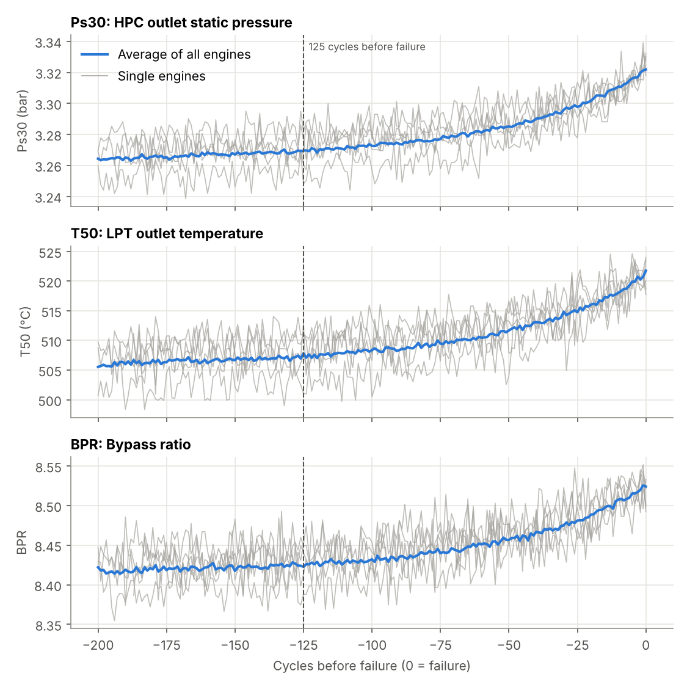
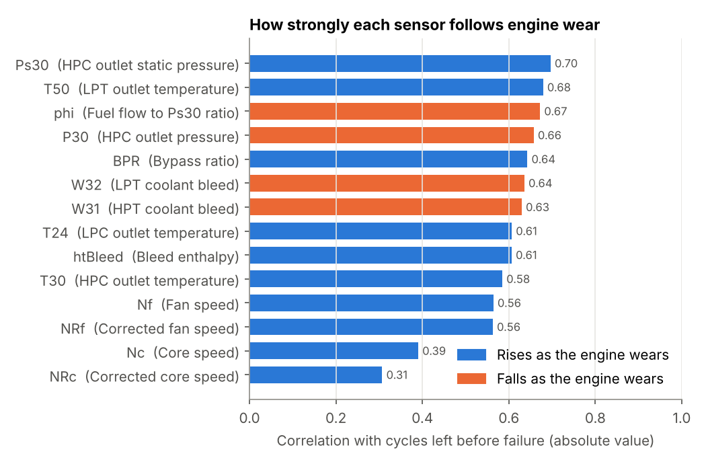
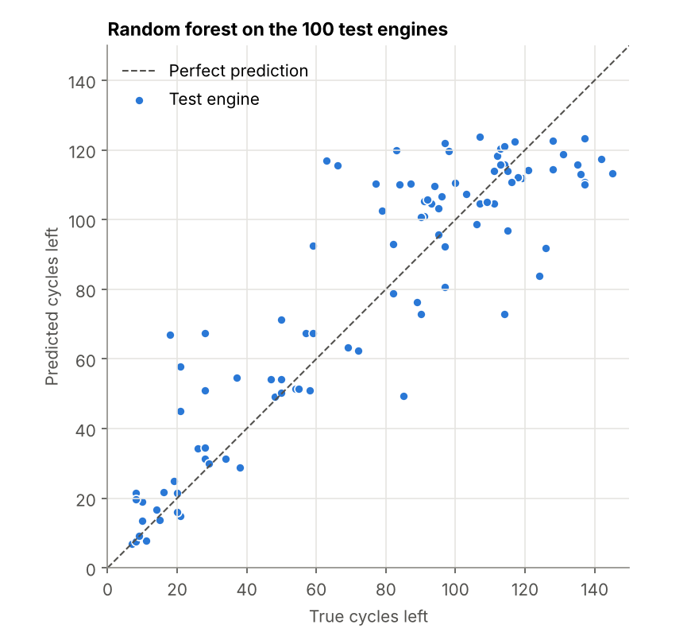

# Jet engine sensor analysis

Which sensors show that a jet engine is wearing out, and can we estimate how many flight cycles it has left?

This notebook works on NASA's C-MAPSS data (subset FD001): 100 simulated engines recorded from a healthy state until failure, one row per flight cycle, 21 sensors per row.

## What the notebook does

1. Loads the raw text files and names the 21 sensors from the NASA documentation.
2. Converts temperatures from degrees Rankine to °C and pressures from psia to bar, and drops the 7 sensors that never change.
3. Measures how strongly each of the 14 remaining sensors follows engine wear.
4. Lines the engines up on their failure point to see when the sensors start to drift.
5. Estimates the cycles left with a linear regression and a random forest, tested on NASA's 100 test engines.

## Results

| | |
|---|---|
| Training data | 20,631 cycles from 100 engines, life from 128 to 362 cycles |
| Sensors kept | 14 of 21 |
| Best wear indicators | Ps30 (HPC outlet static pressure), T50 (LPT outlet temperature), phi (fuel flow ratio) |
| When they drift | 86% to 99% of the drift over the last 200 cycles happens in the last 125 |
| Linear regression | RMSE 21.9 cycles, MAE 17.6 cycles |
| Random forest | RMSE 18.4 cycles, MAE 13.4 cycles, 75% of test engines within 20 cycles |







## Design choices

- **Units:** Rankine and psia are hard to read, so the plots use °C and bar. Every axis has a label and a unit.
- **Target capped at 125 cycles:** the sensors stay flat for most of an engine's life and only drift near the end. A reading can tell "close to failure" from "healthy", but not 300 cycles left from 200, so every engine with more than 125 cycles left counts as 125. This cap is a common choice for this data set.
- **Two simple models:** a linear regression as a baseline and a random forest, which handles the curved drift better. No tuning on the test set.

## Limits

The data is simulated, with one operating condition and one fault type. Real engines run under changing conditions, so the sensors would first need to be normalised per condition. 16 of the 100 test engines get more than 20 extra cycles, which in real use would mean late maintenance.

## How to run

```bash
pip install -r requirements.txt
jupyter notebook analysis.ipynb
```

## Data

NASA C-MAPSS jet engine simulated data, from the NASA Open Data Portal: https://data.nasa.gov/dataset/cmapss-jet-engine-simulated-data

A. Saxena, K. Goebel, D. Simon and N. Eklund, "Damage Propagation Modeling for Aircraft Engine Run-to-Failure Simulation", Proceedings of the 1st International Conference on Prognostics and Health Management (PHM08), Denver, CO, October 2008.
